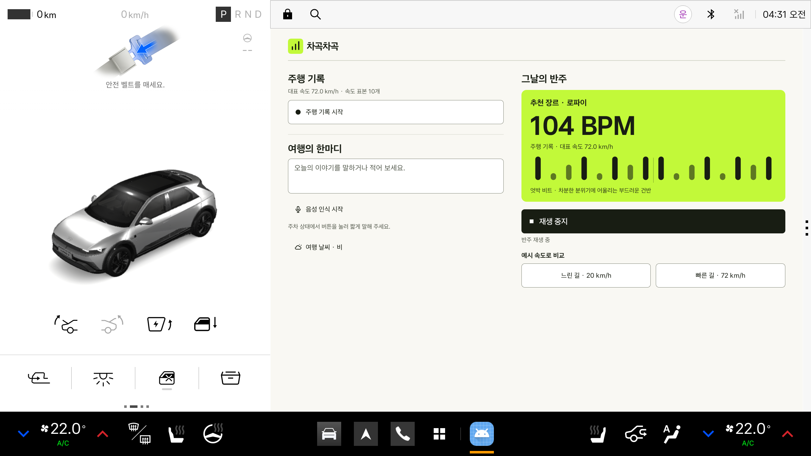

# 차곡차곡 · Chagok Chagok

**함께 달린 속도로, 여행의 한마디에 반주를 더해요.**

차곡차곡은 자동차 여행에서 남긴 이야기를 담고, 그날의 주행 속도와 가감속에 맞춰 반주를 편곡하는 Pleos Connect 앱입니다. 주차 중에 이야기를 적거나 말하고, 도착한 뒤 그 길의 빠르기와 리듬을 다시 들어볼 수 있습니다.



## 바로 들어보기

1. Pleos Connect 에뮬레이터를 켜고 [서명된 릴리스 APK](apk/차곡차곡_차곡차곡_release.apk)를 설치합니다.
2. 주차 상태에서 **여행의 한마디**에 이야기를 적고, **여행 날씨**에서 그날의 날씨를 선택합니다.
3. **느린 길 · 20 km/h**를 고른 후 **반주 듣기**를 누릅니다. **빠른 길 · 72 km/h**로 바꿔 같은 멜로디의 속도를 비교합니다.

반주 화면에 속도의 출처와 추천 장르가 표시됩니다. 연두색 영역의 막대는 실제로 재생되는 두 마디의 드럼 패턴입니다.

## 주행 기록으로 반주 만들기

1. 주차 상태에서 **주행 기록 시작**을 누르고 차량 속도 권한을 허용합니다.
2. `adb forward tcp:8088 tcp:8088`을 실행하고 [Pleos Virtual Console](http://127.0.0.1:8088/)을 엽니다.
3. 콘솔에서 `D`를 선택한 뒤 `ACCEL`을 눌러 몇 초간 주행합니다. Pleos는 주행 중 앱 화면을 가리고, 이미 시작한 속도 기록은 백그라운드에서 이어집니다.
4. `P`로 돌아온 뒤 **기록 마치기 → 반주 듣기**를 누릅니다.

| 입력 | 반주에 반영되는 내용 |
| --- | --- |
| 전진 표본의 중앙값 | 30 km/h 미만은 84 BPM, 30 이상 60 km/h 미만은 94 BPM, 60 km/h 이상은 104 BPM |
| 기록 중 가속·감속 | 연속된 1초 간격 전진 표본에서 8 km/h 이상 변화가 두 번 이상 잡히면 드럼에 엇박을 더합니다 |
| 선택한 날씨와 이야기 | 맑음과 활기찬 표현은 시티팝, 비나 차분한 표현은 로파이, 눈이나 포근한 표현은 어쿠스틱을 추천합니다 |
| 유효 표본 부족 | 기본 반주 94 BPM을 사용합니다 |

8마디 멜로디는 기기에서 합성합니다. 이야기는 주차 중 직접 입력하거나 Pleos SpeechToText의 한국어 온디바이스 인식을 사용해 채울 수 있습니다. 이야기, 선택한 날씨, 마지막 주행 요약은 기기에 저장합니다. 주행 기록은 최대 15분이며, 원본 속도 표본은 요약을 만든 뒤 폐기합니다.

## 개발 및 실행

| 항목 | 검증 환경 |
| --- | --- |
| 앱 | Kotlin · Android Automotive OS · Android API 34 |
| 빌드 | JDK 17 · Gradle 8.14.3 |
| 에뮬레이터 | Pleos Connect v2.1.0 · Apple Silicon ARM64 · Cold boot · RAM 4 GB |
| 화면 | 2560 × 1440 · 160 dpi |
| SDK | AAOS `CarPropertyManager` · Pleos SpeechToText 3.3.1 |

공식 가이드를 따라 Pleos 시스템 이미지를 설치한 뒤 프로젝트 루트에서 실행합니다. [Pleos 설치 가이드](https://document.pleos.ai/docs/connect/guide/getting-started/application-development/setup-connect-sdk-emulator)

```sh
./gradlew :app:assembleDebug :app:lintDebug
adb install -r app/build/outputs/apk/debug/app-debug.apk
adb shell am start -W -n com.taeppir.chagokchagok/.MainActivity
```

서명된 배포 APK를 바로 실행할 수도 있습니다. 디버그 빌드와 배포 APK는 서명키가 다르므로 각각 별도 AVD에서 설치하면 됩니다.

```sh
adb install 'apk/차곡차곡_차곡차곡_release.apk'
adb shell am start -W -n com.taeppir.chagokchagok/.MainActivity
```

## 검증 범위

- 서명된 APK를 새 Pleos 에뮬레이터에 설치해 실제 가상 주행 신호를 검증했습니다. 일정하게 달린 20 km/h 기록은 84 BPM의 고른 비트로, 가감속을 섞은 72 km/h 기록은 104 BPM의 엇박 비트로 재생됐습니다. 비를 선택하면 로파이가 추천됩니다.
- Pleos 음성 엔진이 한국어 음성을 텍스트로 변환하는 것을 로컬 PCM 시험에서 확인했습니다. 에뮬레이터에서 마이크 전달이 불안정할 때는 이야기 입력란으로 동일한 장르 추천을 시연할 수 있습니다.
- 날씨는 화면에서 선택합니다. 보컬곡 생성은 ElevenLabs Music 등으로 확장할 수 있으며 현재 APK에는 기기에서 재생하는 반주가 포함됩니다. [ElevenLabs Music 가이드](https://elevenlabs.io/docs/eleven-api/guides/how-to/music/composition-plans)
