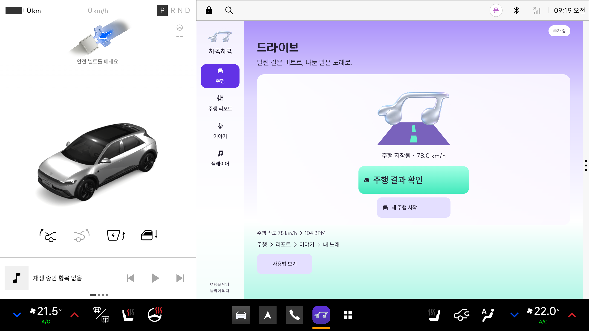
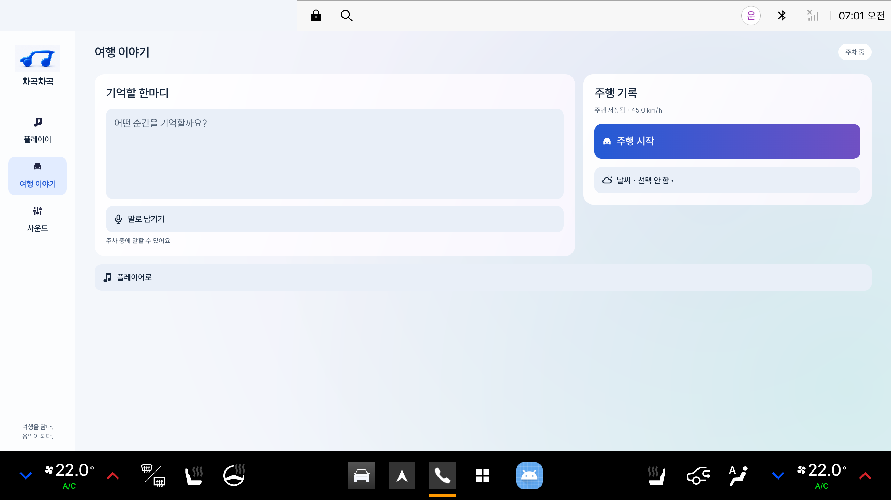
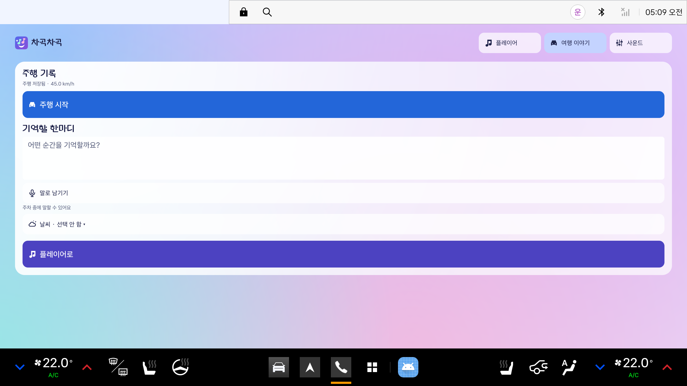

<div align="center">


# 차곡차곡
### 달린 길은 비트로, 나눈 말은 노래로.

**주행 데이터와 차 안의 이야기를 나만의 음악으로 남기는 Pleos Connect 차량용 앱**

가족과 처음 떠난 바다, 친구들과의 당일치기, 혼자 달린 밤길.<br />
차곡차곡은 그날의 움직임과 이야기를 담아, 다시 들을 수 있는 추억을 만듭니다.

**차곡LAB · Pleos Connect · Kotlin · AI Music**

[▶ 3분 시연 영상](demos/chagok-demo.mp4) · [APK 다운로드](apk/차곡LAB_차곡차곡_release.apk)

</div>


## 이동의 순간을, 오래 듣는 음악으로

여행에서 남기고 싶은 것은 목적지뿐만이 아닙니다. 가는 길의 설렘, 함께 나눈 말, 비 오는 창밖의 분위기도 그날의 추억입니다.

차곡차곡은 **차량 신호를 비트로**, **탑승자의 이야기를 가사로** 연결합니다. 도착 후 내 차가 만든 리듬을 확인하고, 원하는 장르와 이야기를 더해 한국어 보컬곡을 만들 수 있습니다. 완성한 음악은 보관함에 차곡차곡 쌓이고, 다시 듣거나 파일로 저장할 수 있습니다.

## 차곡차곡의 세 가지 경험

| 경험 | 서비스가 하는 일 |
|:---|:---|
| **내 차가 만드는 비트** | 속도·가감속과 차량 장치의 상태 변화를 수집해 템포, 드럼, 악기 패턴에 반영합니다. 주행 리포트에서 데이터와 소리의 연결을 확인하고 악기별로 들어볼 수 있습니다. |
| **우리 이야기가 담긴 노래** | 대화 전사·요약을 확인하고, 남기고 싶은 이야기를 직접 수정하거나 음성 메모로 더합니다. 선택한 장르와 편곡 정보를 바탕으로 AI가 한국어 가사와 보컬곡을 생성합니다. |
| **다시 꺼내 듣는 드라이브** | 회전하는 CD와 가사가 함께하는 플레이어에서 감상합니다. 제목 수정, 반복 재생, MP3·WAV 저장, Android 공유 기능을 제공합니다. |

가사 없이 **차량 데이터로 만든 로컬 비트만 감상하고 저장**하는 것도 가능합니다.

## Pleos와 만나, 차가 음악의 재료가 됩니다

차곡차곡은 **Pleos Vehicle SDK로 읽은 차량의 변화**를 음악적 표현에 연결합니다. 이동 속도뿐 아니라 와이퍼, 창문, 문, 깜빡이, 공조 상태까지 편곡의 재료가 됩니다.

| 차량 데이터 | 로컬 비트에 반영되는 요소 |
|:---|:---|
| 속도 · 가감속 | 템포 · 드럼 리듬 |
| 와이퍼 · 창문 | 셰이커 · 벨 |
| 문 · 깜빡이 | 클랩 · 림샷 |
| 설정 온도 · 내기 순환 | 신스 · 퍼커션 |

드럼과 베이스 위에 차량 신호에 따른 악기가 더해집니다. **어떤 기록이 어떤 소리로 이어졌는지** 직접 확인할 수 있어, 내 이동이 음악이 되는 과정을 듣고 이해할 수 있습니다.

로컬 비트는 차량 기록으로 직접 합성하고, AI 보컬곡은 그 편곡 정보와 이야기를 텍스트로 전달해 생성합니다.

## 출발부터 한 곡까지

1. **출발 전, 주행 시작** — 차량 신호와 함께 여행의 기록을 시작합니다.
2. **도착 후, 내 차의 비트 확인** — 주차 후 주행을 마치고 리포트에서 기록 수치와 악기 소리를 확인합니다.
3. **남기고 싶은 이야기 선택** — 이야기 노트를 확인·수정하고 원하는 장르를 고릅니다.
4. **노래 만들기** — 그날의 이야기와 편곡 정보를 담은 한국어 보컬곡을 생성합니다.
5. **감상하고 간직하기** — 내 음악에서 다시 듣고, 음원 파일로 저장하거나 Android 공유 기능을 이용합니다.

주행 중에는 화면 조작을 제한하고, 리포트 확인과 곡 만들기는 주차 후 진행하도록 구성했습니다.

<table>
<tr>
<td width="50%"></td>
<td width="50%"></td>
</tr>
<tr>
<td align="center"><b>출발 전, 기록을 시작하고</b></td>
<td align="center"><b>도착 후, 내 차의 비트를 듣고</b></td>
</tr>
<tr>
<td width="50%"></td>
<td width="50%"></td>
</tr>
<tr>
<td align="center"><b>우리의 이야기를 더해</b></td>
<td align="center"><b>한 곡의 추억으로 간직합니다</b></td>
</tr>
</table>

## 세 번의 이동, 세 곡의 추억

서로 다른 주행 기록과 이야기가 어떤 음악으로 이어지는지 세 가지 시연곡으로 경험할 수 있습니다.

| 시연곡 | 담고 싶은 순간 | 장르 | 차량 기록 기반 로컬 비트 |
|:---|:---|:---|:---|
| **처음 만난 바다** | 아기와 함께하는 첫 바다 여행 | 어쿠스틱 | 84 BPM |
| **할머니 집 불빛** | 비 오는 날, 가족과 할머니 댁으로 | 로파이 | 94 BPM |
| **조개구이 가는 길** | 시험이 끝난 친구들과 인천으로 | 힙합 | 104 BPM |

**세 곡 모두 APK에 포함되어 있어, 설치 후 오프라인으로 바로 감상할 수 있습니다.**

시연은 Pleos 에뮬레이터의 Virtual Console에서 조작한 차량 신호를 앱이 수집한 기록과 창작 이야기를 사용했습니다.

## 바로 체험하기

1. [서명된 APK](apk/차곡LAB_차곡차곡_release.apk)를 내려받아 Pleos 에뮬레이터에 설치합니다.
2. 앱의 **플레이어 → 내 음악**에서 세 곡의 시연 음악을 감상합니다.
3. 주행 기록을 만들고 **주행 리포트**에서 차량 데이터에 따른 로컬 비트와 악기 소리를 확인합니다.

저장된 곡 재생과 로컬 비트는 AI 생성 API 호출 없이 동작합니다. 새로운 보컬곡 생성과 대화 요약은 아래 개발 환경 설정이 필요합니다.

## 기술 구성

| 영역 | 기술 |
|:---|:---|
| 차량 앱 | Kotlin · Android Automotive OS API 34 |
| 차량 연동 | Pleos Vehicle SDK · Android CarPropertyManager |
| 음성·이야기 | Pleos SpeechToText · Gemini |
| 음악 | AudioTrack 기반 로컬 합성 · Google Lyria |
| 서버 | Python · 생성 요청 캐시 · 일일 생성 한도 |
| 화면 | Native Android Views · Canvas · Gugi · SUIT |

<details>
<summary><b>개발 환경 및 실행 방법</b></summary>

### 환경

- JDK 17 · Gradle 8.14.3 · Python 3.9+
- Pleos Vehicle 2.3.2 · Pleos SpeechToText 3.3.1
- 검증 환경: Pleos Connect v2.1.0 ARM64 시스템 이미지 · Android Emulator 37.2.12 · API 34
- 화면: 2560×1440 px / 160 dpi, 차량 패널과 앱을 함께 띄운 분할 화면

### 빌드 및 설치

```sh
./gradlew :app:assembleDebug
adb install -r app/build/outputs/apk/debug/app-debug.apk
adb shell am start -n com.taeppir.chagokchagok/.MainActivity
```

### 차량 콘솔 및 음악 서버 연결

`server/.env.example`을 참고해 `server/.env`에 `GEMINI_API_KEY`를 설정합니다. API 키는 서버에서만 관리하며 APK와 Git에 포함하지 않습니다.

```sh
adb forward tcp:8088 tcp:8088
adb reverse tcp:8787 tcp:8787
python3 server/server.py --env-file server/.env
```

Virtual Console은 `http://127.0.0.1:8088`에서 엽니다. 가사 타이밍 분석을 사용하려면 서버 실행 시 `ALIGN_LYRICS=1`을 설정합니다. 이 옵션은 곡 생성 후 추가 분석 요청을 사용합니다.

같은 생성 요청은 캐시된 곡을 재사용하며, 저장된 곡을 다시 재생할 때는 생성 API를 호출하지 않습니다.

자세한 서버 설정은 [서버 실행 안내](server/README.md), 에뮬레이터 검증 내용과 지원 범위는 [검증 기록](docs/VALIDATION.md)을 참고하세요.

</details>

---

<div align="center">

**이동이 끝나도, 우리의 노래는 남습니다.**

차곡LAB · 차곡차곡<br />
<sub>제목 Gugi · 본문 SUIT — 폰트 라이선스 원문은 앱 assets에 포함되어 있습니다.</sub>

</div>

