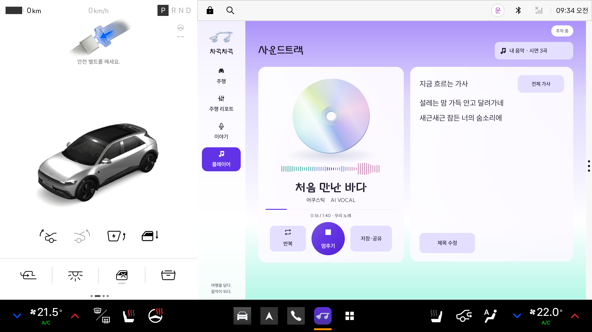

<div align="center">


# 차곡차곡
### 달린 길은 비트로, 나눈 말은 노래로.

차량 신호와 차 안의 이야기를 **우리만의 음악**으로 남기는 Pleos Connect 앱.
가족 여행, 친구들의 당일치기, 혼자 달린 순간까지 한 곡에 담습니다.

**Pleos Connect · Kotlin · AI Music**
</div>



[▶ 3분 시연 영상 — 차량 신호가 음악이 되는 과정](demos/chagok-demo.mp4)

## 차가 음악의 재료가 됩니다

**스마트폰 GPS만으로 알 수 없는 차 안의 변화**를 Pleos Vehicle SDK로 읽습니다. 드럼과 베이스 위에 차량 신호가 악기로 더해지고, 탑승자의 이야기는 한국어 가사와 보컬이 됩니다.

| 차량 데이터 | 내 차의 비트 |
|:---|:---|
| 속도 · 가감속 | 템포 · 드럼 리듬 |
| 와이퍼 · 창문 | 셰이커 · 벨 |
| 문 · 깜빡이 | 클랩 · 림샷 |
| 설정 온도 · 내기 순환 | 신스 · 퍼커션 |

## 출발부터 한 곡까지

**주행 시작 → 주차 후 주행 마치기 → 리포트·장르·비트 → 이야기 확인 → 노래 만들기 → 감상·저장·공유**

- **주행 리포트:** 실제 기록 수치와 악기의 연결을 보고, 악기별 소리를 따로 들어봅니다.
- **이야기 노트:** 대화 전사·요약을 확인하고 내용을 수정하거나 음성 메모와 이름을 추가합니다.
- **사운드트랙:** 회전하는 CD, 가사 보기, 제목 수정, 반복 재생, MP3·WAV 저장과 Android 공유.
- **비트만 즐기기:** 가사와 보컬 없이 로컬 비트만 듣고 저장할 수도 있습니다.

<table><tr><td></td><td></td></tr><tr><td align="center">출발 전에 시작하고</td><td align="center">도착해서 내 차의 비트를 확인해요</td></tr></table>

## 서로 다른 세 번의 이동

Virtual Console에서 실제 조작한 차량 신호를 앱이 수집했습니다. 인물·이야기는 창작한 시연 시나리오입니다. **세 곡 모두 APK에 포함되어 오프라인으로 들을 수 있습니다.**

| 시연곡 | 이야기 | 수집 속도 중앙값 → 비트 | 선택 장르 |
|:---|:---|:---|:---|
| 처음 만난 바다 | 아기와 함께하는 첫 바다 여행 | 22 km/h → 84 BPM | 어쿠스틱 |
| 할머니 집 불빛 | 비 오는 날 성인 가족의 할머니 댁 방문 | 45 km/h → 94 BPM | 로파이 |
| 조개구이 가는 길 | 시험이 끝난 대학생 친구들의 인천행 | 78 km/h → 104 BPM | 힙합 |

동일한 로컬 편곡 입력은 동일한 비트를 만들고, 동일한 AI 생성 요청은 저장된 곡을 재사용합니다. AI 보컬곡에는 편곡 정보를 텍스트로 전달하므로 **로컬 비트와 정확히 같은 파형·BPM을 보장하지는 않습니다.**

## 기술 스택

| 영역 | 기술 |
|:---|:---|
| 차량 앱 | Kotlin · Android Automotive OS API 34 |
| 차량 신호 | Pleos Vehicle 2.3.2 · Android CarPropertyManager |
| 음성·이야기 | Pleos SpeechToText 3.3.1 · Gemini 3.5 Flash-Lite |
| 음악 | AudioTrack 로컬 합성 · Google Lyria 3.5 |
| 서버 | Python 3.9+ · 요청 캐시 · 일일 생성 한도 |
| 화면 | Native Android Views · Canvas · Gugi · SUIT |
| 개발 환경 | JDK 17 · Gradle 8.14.3 · Pleos ARM64 Emulator |

## 실행

[서명된 APK](apk/차곡차곡_차곡차곡_release.apk)를 Pleos 에뮬레이터에 설치한 뒤 **플레이어 → 내 음악**에서 바로 체험합니다. 새 비트는 주행을 기록하거나 기본 편곡으로 들을 수 있습니다.

```sh
# 소스에서 빌드·설치
./gradlew :app:assembleDebug
adb install -r app/build/outputs/apk/debug/app-debug.apk
adb shell am start -n com.taeppir.chagokchagok/.MainActivity

# Virtual Console과 음악 서버 연결
adb forward tcp:8088 tcp:8088
adb reverse tcp:8787 tcp:8787
ALIGN_LYRICS=1 python3 server/server.py --env-file server/.env
```

콘솔은 `http://127.0.0.1:8088`에서 엽니다. 새 보컬곡과 대화 요약에는 `server/.env`의 `GEMINI_API_KEY`가 필요합니다. 키는 APK·Git에 넣지 않습니다. `ALIGN_LYRICS=1`은 곡당 한 번의 추가 가사 타이밍 분석을 켭니다. 저장된 곡 재생과 로컬 비트에는 생성 API를 호출하지 않습니다.

**MVP 범위:** 주행 중 화면 제한을 유지합니다. 대화 기록은 최대 30분으로 설계했으며 짧은 구간 전사·요약 경로를 검증했습니다. 실차·장시간 내구성 검증, 실제 음성 삽입, 온라인 커뮤니티, 여행 영상은 후속 범위입니다. Bluetooth 전송은 기기의 공유 지원 여부에 따릅니다.

<sub>제목 Gugi · 본문 SUIT — 라이선스 원문은 앱 assets에 포함합니다.</sub>
